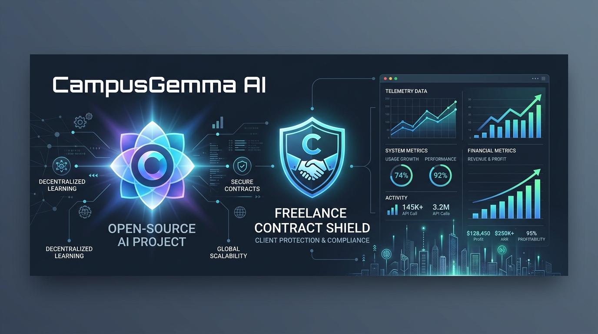
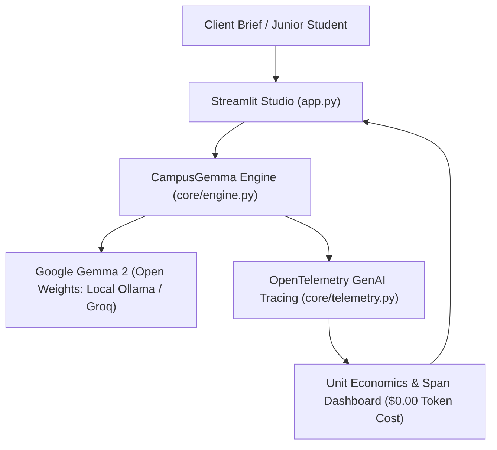

# 💼 CampusGemma AI: The Zero-Cost Student Side-Hustle & Technical Coaching Studio



[](https://github.com/VimalN2005/campus-gemma-ai/actions/workflows/ci.yml)
[](https://opensource.org/licenses/MIT)
[](https://www.python.org/downloads/)
[](https://ai.google.dev/gemma)
[](https://opentelemetry.io/)
[](https://pytest.org)
[](https://campus-gemma-ai-bm7uyhdxvmwbfuy2ak5xkq.streamlit.app/)

**CampusGemma AI** is an open-source technical side-hustle studio built for student freelancers and engineering mentors at **IIIT Bhopal**. It turns messy client WhatsApp/Upwork messages into ready-to-sign **Statements of Work (SOW), engineering milestones, itemized commercial invoices, and pricing quotes**, while powering a **paid 1-on-1 campus mock-interview & code audit service**—all with **$0.00 in API token costs** thanks to **Google Gemma 2 (`gemma2-9b-it`)** open weights.

Built for the **[Hacktoberfest 2026 Week 2 DEV Challenge (Theme: "Side Hustle")](https://dev.to/challenges/hacktoberfest-week2-2026-10-12)** and instrumented with native **OpenTelemetry GenAI Observability**.

👉 **Live Deployed App:** [https://campus-gemma-ai-bm7uyhdxvmwbfuy2ak5xkq.streamlit.app/](https://campus-gemma-ai-bm7uyhdxvmwbfuy2ak5xkq.streamlit.app/)

---

## 🎯 Key Capabilities (Built for Student Side Hustles)

1. **💼 Freelance Proposal & Contract Shield:** Converts raw client requirements into executive summaries, milestone hour breakdowns, dollar quotes, and anti-scope-creep contract boundaries with 1-click Markdown download.
2. **💳 Milestone Invoice & Payment Studio:** Auto-generates formal commercial invoices with itemized deliverables, payment terms, and direct UPI / PayPal settlement instructions to secure payment upon milestone completion.
3. **🎯 Paid Campus Mock-Interview Studio:** Enables senior students to run structured, paid 1-on-1 technical placement interviews for juniors across Distributed Systems, Concurrency, and OS internals with automated 10-point scorecards.
4. **🔬 Rapid Client Code & Security Auditor:** Dissects C++/Python/Go codebases for memory leaks, race conditions, and algorithmic bottlenecks with downloadable reports.
5. **📊 OpenTelemetry GenAI & Unit Economics Tracker:** Live trace spans following OpenTelemetry GenAI semantic conventions (`gen_ai.system`, `gen_ai.request.model`, latency, and cost savings), proving why open weights make micro-SaaS side hustles 100% profitable.

---

## 🏗️ System Architecture



---

## 💡 Why Open Innovation Makes This Side Hustle Work

1. **100% Profit Margin (Zero API Token Burn):** When charging ₹299 ($3.50) for a student mock-interview or pitching 20 freelance clients a week, a $20/month proprietary API subscription eats all the profit. Running Google Gemma 2 keeps inference cost at **$0.00**, making the side hustle profitable from Day 1.
2. **Strict Client NDA & Data Privacy:** Local business owners and freelance clients don't want their private inventory schemas or proprietary code uploaded to closed corporate training clouds. Local execution via Ollama keeps 100% of client data on your laptop.
3. **No Vendor Lock-In:** Swap seamlessly between local `gemma2:9b` via Ollama on a laptop with no internet, or fast open-weight cloud endpoints.

---

## 🚀 Quickstart Guide

```bash
git clone https://github.com/VimalN2005/campus-gemma-ai.git
cd campus-gemma-ai
pip install -r requirements.txt
streamlit run app.py
```

### Run Pytest Suite
```bash
python -m pytest tests/test_engine.py -v
```

---

## 📜 License

Distributed under the **MIT License**. See `LICENSE` for more information.
