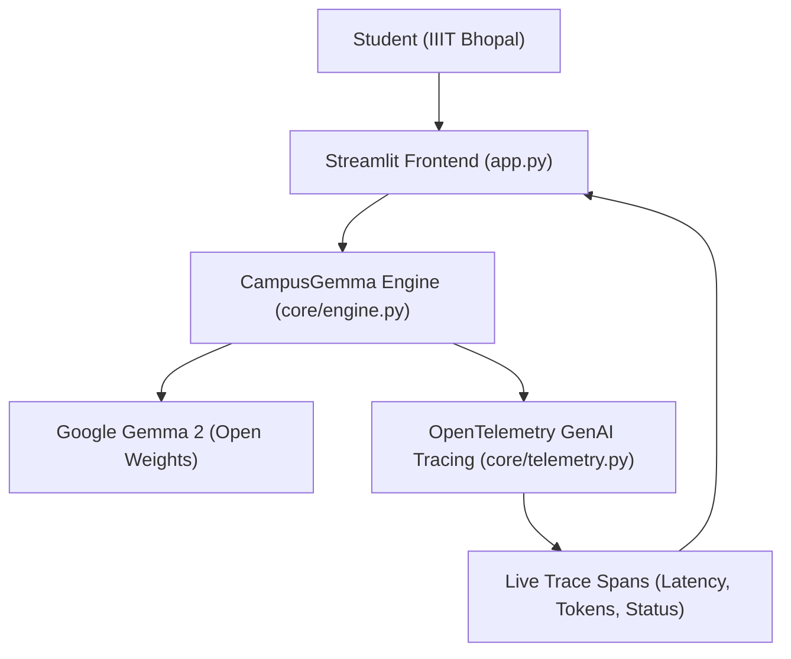

# 🎓 CampusGemma AI: Open-Source College & Hostel Tech Interview Companion

[](https://opensource.org/licenses/MIT)
[](https://www.python.org/downloads/)
[](https://ai.google.dev/gemma)
[](https://opentelemetry.io/)
[](https://pytest.org)

**CampusGemma AI** is an open-source technical placement & systems engineering companion designed for students at **IIIT Bhopal**. It empowers engineering students to simulate rigorous technical interviews (Distributed Systems, Concurrency, Operating Systems, Database Internals) and dissect complex lab code with memory models and edge-case detection.

Built specifically for **Hacktoberfest 2026 Week 2 DEV Challenge**, powered by **Google Gemma 2 (`gemma2-9b-it`)** open weights and instrumented with native **OpenTelemetry GenAI Observability**.

---

## 🎯 Key Capabilities

- **🚀 Deep Systems Interview Simulation:** Generates rigorous scenario-based problems covering Raft/Paxos consensus, cache-line false sharing, lock-free queues, and database isolation.
- **📝 Real-Time Answer Rubric & Evaluation:** Objectively scores candidate answers, highlighting technical strengths, missed concurrency trade-offs, and an industry exemplar response.
- **🔬 Lab Code & Concurrency Dissector:** Explains complex C++/Python lab code with memory layout (Stack/Heap), thread safety analysis, and deadlock warnings.
- **📊 OpenTelemetry GenAI Observability:** Native in-memory span telemetry following OpenTelemetry GenAI semantic conventions (`gen_ai.system`, `gen_ai.request.model`, latency, and tokens).
- **🔒 100% Open & Offline-First:** Supports ultra-fast cloud inference, local **Ollama (`gemma2`)**, and a zero-dependency deterministic simulation mode so anyone can evaluate the app with zero API keys.

---

## 🏗️ System Architecture



---

## 🚀 Quickstart Guide

### 1. Clone & Install
```bash
git clone https://github.com/VimalN2005/campus-gemma-ai.git
cd campus-gemma-ai
pip install -r requirements.txt
```

### 2. Run the Application
```bash
streamlit run app.py
```

### 3. Run Test Suite
```bash
python -m pytest tests/test_engine.py -v
```

---

## 💡 Why Open Innovation Matters

1. **Hostel & Student Privacy:** Technical preparation notes, practice answers, and weakness evaluations remain private to the student and are never harvested by closed cloud AI platforms.
2. **Zero Barrier to Entry:** Engineering students shouldn't have to pay expensive monthly subscription fees to drill system design or get constructive feedback on their lab code.
3. **True Local Portability:** With local Ollama execution, students can run deep systems simulations on laptops in the library or train journeys with zero internet connection.

---

## 📜 License

Distributed under the **MIT License**. See `LICENSE` for more information.
